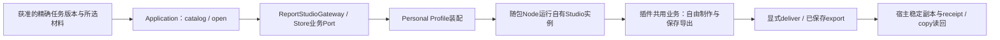

# Report Studio参考Adapter（本地待审）

这是已发布实现的导览与合成用法，不是复制的新Adapter或第二插件。适用原则见[标准](standard.md)，核查选择见[清单](acceptance-checklist.md)，本次实际结果和本机证据根见[验证记录](../../../openspec/changes/plugin-integration-consolidation/verification.md)。下列身份为历史固定参考，不自动跟随main或重新构建。

## 参考发布与固定物料

| 对象 | 已核对身份与限制 |
|---|---|
| JuanerAI源码发布 | PR91，squash `3deeaae7b352b49afb46d4811fbd17689d2c277a`；最终PR head `37648b56bb4e9f5c1674f0300b6a212860cfa82d` CI成功。当前新资产以该发布提交起树，未产生新提交 |
| 业务源 | [source-identity.json](../../../vendor/reports-factory/74ebb609/source-identity.json)：`reports_factory`固定提交`74ebb609fd73cf263614ffc9301dafaafcec4230`；选定81普通源码／资源，非当前原仓维护线 |
| 固定源tar | 同目录`source.tar`，1628160 bytes，SHA `a5cba2b9dc44011d6177068df504483b2550d6c77e958a8c76d0de80a119e62a`；不含业务data/work／认证 |
| 已验034模块 | version `0.1.0-juanerai.1`，protocol `1`，manifest SHA `d59d0554314c7e3c832944dd9f6bc6c8a31df3b7c862b119bd7a540c5551da19`，22716资源；相同版本字符串不能替代manifest身份 |
| 原034应用／交付ZIP | 应用25593项、清单SHA `fd26ae55e33778c4b9453711f5d88a19f74beaf6425828373e50cc910cfb9fe8`；ZIP468266662 bytes、SHA `793a67d1a2aa9f6e5682563a07c07ee6fa1e62a235e83174e62c9998b95fa4a0`。原接受／路径在[035实际结果](../../../openspec/changes/archive/2026-10-16-report-studio-minimal-integration/notice-install-result-035.md)；本次不操作真实安装 |
| 依赖 | Studio原锁SHA `15fa17b9b552dc7f7a73f352568ceea327ef16a9e2c4e9753de116e02f9f5097`、包内SDK0.4.1、Pi两包0.86.1；宿主SDK0.5.1独立固定。实际SDK导出createSessionRuntime及budgets/storage/bindOperation/reconcile等声明已读，本次不升级或统一 |

原发布前置是已获准源码交付与限定接受，不要求npm公开发行或生产部署。PR90融合源码有隔离浏览器／Vite资源证据，Mini真实现装仍034，不能称融合.app已重新安装。AC01是用户接受未实测风险，MacBook原接受／免测、所有FAIL／UNKNOWN／未知预留按原记录保留。

## 真实调用链与源码接点



| 接点 | 已发布文件／真实Interface | 正负验证与不应外推的范围 |
|---|---|---|
| 输入及版本 | [report-studio-source.ts](../../../packages/application/report-studio-source.ts)：`reportStudioMaterialCatalog`、`selectReportStudioMaterials`；只投影模型解释／汇总，不序列化整个Task或原始数据 | [source单元](../../../tests/unit/xanthil-desktop/report-studio-source.unit.test.ts)：精确saved版本、选材与缺版本拒绝；这些材料类型是报告专属 |
| 业务协调 | [report-studio.ts](../../../packages/application/report-studio.ts)：`createReportStudioWorkspace`，catalog/open/continueProject/deliver/receipt/copy | [workspace集成](../../../tests/integration/xanthil-desktop/report-studio-workspace.integration.test.ts)：丢创建回执仍同一pending身份、错项目／删来源拒绝、交付幂等及稳定字节 |
| 业务Port | [ports/report-studio.ts](../../../packages/ports/report-studio.ts)：Gateway的ensureProject/project/savedExport；Store保存关联与成果副本 | 不传Pi私有类型，不用报告的Association、PPT格式和状态作统一插件Schema |
| 具体装配 | [profiles/personal/report-studio.ts](../../../profiles/personal/report-studio.ts)：显式bundleRoot／identity／dataRoot，懒启动、项目映射、owner配置 | 固定资源在启动前校验；报告查看不自动唤醒Studio；不是Runtime注册／选择平台 |
| 进程及通信 | [process.ts](../../../adapters/report-studio/process.ts)、[gateway.ts](../../../adapters/report-studio/gateway.ts)、[local-access.ts](../../../adapters/report-studio/local-access.ts)：自有child、IPC ready＋HTTP握手、owner token、一次性bootstrap、浏览器cookie、loopback／origin守卫 | [process集成](../../../tests/integration/xanthil-desktop/report-studio-process.integration.test.ts)、[gateway合同](../../../tests/contract/xanthil-desktop/report-studio-gateway.contract.test.ts)、[准入集成](../../../tests/integration/xanthil-desktop/report-studio-local-access.integration.test.ts)；纯库无需这些进程机制 |
| 停止及授权 | [policy.ts](../../../adapters/report-studio/policy.ts)和上述生命周期：配置不等于外发许可；running/stopping/unknown与真实settlement分开 | [policy合同](../../../tests/contract/xanthil-desktop/report-studio-policy.contract.test.ts)：撤权／材料或接收方变化拒绝；UNKNOWN不清账或盲重放 |
| 稳定交付 | [store.ts](../../../adapters/report-studio/store.ts)：仅宿主关联和显式已保存导出副本，哈希／内容一并持久，独立连接读回 | [store合同](../../../tests/contract/xanthil-desktop/report-studio-store.contract.test.ts)：事务／回执丢失、错来源／坏字节与链接拒绝；工作项目丢失不删除已有副本 |
| UI接线 | [report-studio-client.mjs](../../../apps/browser/report-studio-client.mjs)、[report-studio-http.ts](../../../apps/browser/report-studio-http.ts)和既有workbench：入口／选材／回程／下载 | 原有效UI、033实际制作／原生质量、036宽窄快专业证据按原候选复用；本次没有新UI或产品验收 |

`ensureProject`仅建立／取得项目，不生成报告；`savedExport`仅取明确已保存产物。Application先查历史receipt；丢交付回复时读原副本，不再次发送模型或重复副作用。返回历史来源保持精确revision，缺失不回退最新；可编辑报告不自动继承原分析核验或正式决定身份。

## 共用业务与两套入口

固定tar的`package.json`保留独立`start`／`serve`→`dist/server/start.js`及独立前端构建，服务默认使用其自己的工作区。这是已读源码入口，**本轮未启动独立版，也未制作或验收新的独立发行包**。

[prepare-source.mjs](../../../tools/report-studio/prepare-source.mjs)从固定源做精确兼容编辑并复制[supplier接点](../../../adapters/report-studio/supplier/entry.ts)，形成内置`dist/juanerai/entry.js`。它继续调用原业务构建器、制作、编辑和导出实现；`VITE_REPORT_STUDIO_BUILTIN=1`选择内置UI接线，独立默认路径保留。现存历史中立修复尚需原仓回流核实，不将这种有限固定补丁状态称为已达到未来原仓单线维护目标。

[build-bundle.mjs](../../../tools/report-studio/build-bundle.mjs)消费显式已构建源、固定Node／Chromium／依赖和通知；[bundle.ts](../../../adapters/report-studio/bundle.ts)验证完整manifest、角色／文件／哈希／链接及兼容。构建物料带程序资源，Profile在Resources内定位固定模块，写数据根在宿主用户空间；[runtime-resources.mjs](../../../tools/desktop/runtime-resources.mjs)闭合宿主运行资源。宿主启动自己拥有的随包进程，用户无需另装Studio或保有原仓。

构建、封装、安装、运行采用及用户接受分别证明；源码有脚本不等于每种分发已通过。固定完整包及原验收证据可复用，本次只读核对034 manifest与实际文件，不重封装／安装／运行真实服务。`package.mjs`是已有历史封装配方，不是本次应执行的命令。

## 最小离线用法：直接运行既有合成消费者

环境：已有获准Node26，不安装依赖。下列用例只跨真实Application／Store接点，Gateway为合成实现，材料与SQLite均临时生成；不启动真实Studio／Keychain或访问Provider。不要将它们替换为供应项目的`npm start`。

```sh
node --experimental-strip-types --test --test-concurrency=1   tests/unit/xanthil-desktop/report-studio-source.unit.test.ts   tests/integration/xanthil-desktop/report-studio-workspace.integration.test.ts
```

在workspace用例中：`fixture`创建精确saved Task、真实Store和合成Gateway→`app.open(taskId,'1',['conclusion'])`得到ready→合成savedExport交给`app.deliver`→重复deliver／receipt返回同记录→`app.copy`取得相同字节。删除合成工作项目后副本保持；请求不存在revision、错项目或删来源时实际拒绝。四个workspace用例提供完整可运行用法，不复制生产执行器或额外维护一套业务实现。

扩展资源、通信、权限、生命周期覆盖的精确8文件命令及实际输出见本Change验证和`offline-002.command.json`。包内固定SDK的真实codec合成接点见[工具准入合成消费者](../../../tools/report-studio/supplier-tool-admission.test.mjs)与[图像purpose合成消费者](../../../tools/report-studio/supplier-image-purpose.test.mjs)：createPiTransport使用注入假fetch，createSessionRuntime与合成预算／审计，不使用Provider密钥；它们的既有证据按原固定身份和作用域复用，不把本文合成Gateway称成Provider、SDK全机制或原生应用实测。新插件启用LLM时仍需它自己的实际SDK编解码合成用例和业务场景。本轮首次9文件共95PASS/3个环境FAIL，三例Profile依赖yaml/typebox在新树不存在；原失败保留且不安装、不弱化测试。8文件检查不替代这三例的新执行证明。

## 复用粒度

| 级别 | 当前可用内容 | 下一接入Agent应如何使用 |
|---|---|---|
| 可直接复用 | 本入口、标准的信息项、五步流程、可选择清单；已存在且合同相同的函数／校验工具 | 先证明合同、环境和权限相同，再在现有接点调用；不是将所有ReportStudio文件跨域照搬 |
| 仅参考模式 | 业务Port注入、显式Profile、固定资源／自有进程、同版输入、稳定副本和未知回执读回 | 按实际业务语义采用；第二实际消费者获准后再决定必要共享代码 |
| 报告专属 | 材料classification、Association、project_id格式、制作UI、PPTX/HTML/PDF、Keynote、图检／逐页编辑和报告数据库表 | 只作报告例子，不套给清洗／采集，不合并其他插件的存储／Session |
| 尚未通用化 | 第二插件、新语言／协议、通用库或进程执行器、插件市场、动态装载／热换、企业隔离 | 本轮不提供实现或就绪承诺，等真实消费者和明确授权 |

## 中立业务修复与维护状态

只读范围：本机已发布源码、原81文件固定tar、原034固定包及既有证据。Mini没有可确认的原仓当前维护checkout；本轮未访问MacBook／其他机器或联系其他session，未取得两项回流commit／回归／新版目标物料回执。用户已指定原仓开发任务负责两修复，本任务不执行。以下UNKNOWN不阻断本次R0整理，也不追溯增加原接入收口前置。

| 差异／归属 | 固定74ebb609原始输入 | 已验宿主034目标 | 当前原仓／未来目标状态与处理 |
|---|---|---|---|
| PPTX嵌入XLSX chart table ref尾部多余单引号，中立业务修复 | 原export-deck无修复调用 | [pptx-compat.ts](../../../adapters/report-studio/supplier/pptx-compat.ts)经prepare-source固定接入；编译目标SHA `26382f3aadc3d91b4716903ef585b51088eba0b388f86baac679cbc16d3b9a36`，原Keynote／导出回归有效 | 回流执行状态／commit／原仓回归及未来包包含性均UNKNOWN。归reports-factory任务，保留当前已验补丁，不搬代码 |
| HTML导出丢head/style、双页CSS需隔离，PDF共用路径，中立业务修复 | 原extractBody丢页面head | prepare-source保存完整页面srcdoc；编译export-deck SHA `4928f2a5632a56cedb4036f386b65aaded45976a17cd74889d709c91acd582b2`，027回归／033可读证据保留 | 同上；没有证据不能宣称“已回流”或“已回流未交付”。未来升级须核查包含性，现任务不升级 |
| owner／bootstrap／材料授权／任务关联／稳定副本／凭据与数据隔离／随包通知，宿主专属 | 独立版无宿主接点 | JuanerAI Adapter、supplier兼容层及构建配置已携带 | 宿主专属无需按中立业务修复回流；不扩成所有这些差异都应进入原仓 |

“宿主034已包含”有固定manifest、逐文件哈希及明确修复接点证据；不推定当前原仓包含，不声称原仓与目标均包含。未来不能证明保留两修复时，只建议阻止**那次新升级**并保留旧包；回流、换包与验证由相应获准任务处理。完整本机比较结果是`reference-and-reflow-readback.json`。
