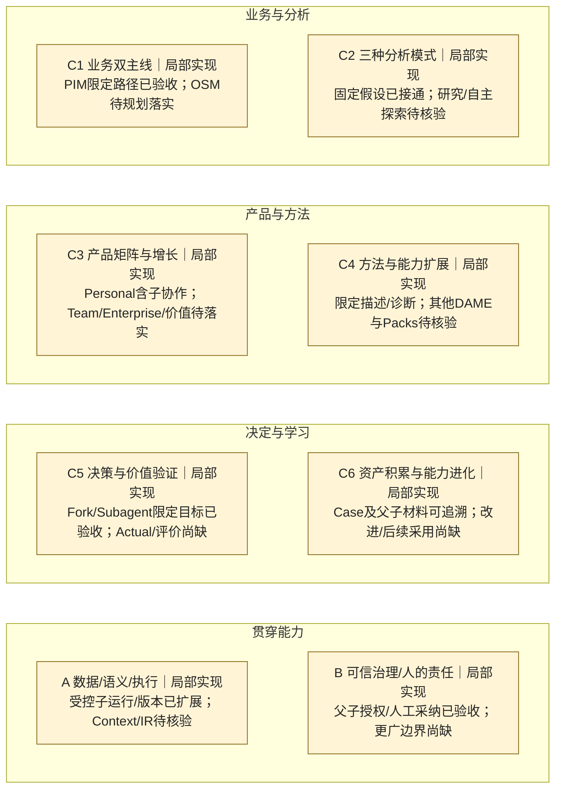

## pi-r1-r4-repair正式Git交付/归档定位（2026-10-15）

已接受离线子范围的源码、测试、固定依赖、原件与规格进入本任务正式Git/归档交付。当前 [归档记录](../../../openspec/changes/archive/2026-10-15-pi-r1-r4-repair/publication.md) 与 [完整六＋二/40ID快照](snapshots/pi-r1-r4-repair-git-delivery-2026-10-15.md) 绑定实际PR/最终head CI/merge/sync回执；未完成效果不预报PASS。原接受范围/40ID/完整目标/累计状态不变，F-ROLE-01及原正式BLOCKED、历史失败/UNKNOWN保留，生产/Provider/共享SDK发布不放行。旧快照按源提交读取，当前链接使用归档路径。

## pi-r1-r4-repair 用户产品接受 · 2026-10-15

用户原话“采纳，接受产品”。本冻结R1～R4＋D1～D8 A既有离线合成/显式opt-in交付范围已有Engineering Acceptance（附本候选F-ROLE-01具名豁免）与明确用户Product Acceptance。**原正式Validator BLOCKED保留，技术PASS不变，不称无条件Validator PASS。** 用户没有逐条16项操作回执，不补造本人复跑，也不把真实Provider/生产未测项标通过。

增量为C3-01、C6-01、A-03/04/05、B-01/02/03的本候选限定离线接受子范围；40稳定ID/定义/完整目标/累计状态保持，不升级完整能力或S1。代码/SDK/测试未改，Git集成/归档/生产仍未执行，原FAIL/UNKNOWN全部保留。以下旧“未产品接受”段落是原时点历史。

[产品接受原话与边界](../../../openspec/changes/archive/2026-10-15-pi-r1-r4-repair/product-acceptance.md) · [全40ID接受快照](snapshots/pi-r1-r4-repair-product-accepted-2026-10-15.md) · [证据](evidence.md#e-pi-r1-r4-product-20261015)

| 六＋二家族 | 本次接受范围/增量 | 仍保留的缺口 |
|---|---|---|
| C1 业务双主线 | 复用原PIM/任务链，未新增完整OSM验收 | 行动/Actual/完整OSM闭环 |
| C2 分析模式 | 既有消费者离线修复获接受，未新增模式验收 | 完整Deep Research/所有场景模型质量 |
| C3 产品矩阵 | C3-01当前冻结浏览器离线交付面获用户产品接受 | 正常生产采用、持续真实使用、Team/Enterprise/价值留存 |
| C4 方法扩展 | 既有IR/计算/独立核验链保留，无新方法全目标验收 | 因果/预测/完整Domain或Model Pack |
| C5 决策与价值 | 准备/采纳/保存/正式效果区分的既有链保留 | 现实行动/Actual/完整Report Studio |
| C6 资产与进化 | C6-01准备正文/重开/失效/旧历史兼容的限定离线子范围接受 | 通用恢复/跨项目学习/长期效果；历史Task迁移未授权 |
| A 数据语义执行 | A-03/04/05固定SDK .3实际IR/准入/计量/证据/主备离线子范围接受 | 真实Provider、生产参数UNKNOWN、通用方法和所有数据格式 |
| B 治理与责任 | B-01/02/03安全诊断/UNKNOWN/Owner/授权/显式采纳限定离线子范围接受，保留具名F-ROLE-01 | 强制只读沙箱残余风险、企业治理/现实行动；生产/Git权限未授予 |

## pi-r1-r4-repair 工程接收回填 · 2026-10-15

本冻结 R1～R4＋D1～D8 A **离线合成 opt-in Engineering Acceptance，附 F-ROLE-01 用户具名豁免**。Validator 原正式 BLOCKED 保留，技术评估 PASS，非无条件 Validator PASS；4610 PASS/1 Provider SKIP，独立131 PASS。仅回填收口记录，原代码/SDK/测试不变，未执行 Git 集成或正式归档。

本次支持 C6-01、A-03/04/05、B-01/02/03 的已有消费者；40稳定ID、全部目标/完成条件、累计状态、此前已接受子范围不变。不把离线工程结果提升为用户 Product Acceptance、S1 或新全目标交付。原失败、旧字段、UNKNOWN 和 Provider/生产/Git 停止线保留。下文旧“当前”按历史时点阅读。

[工程接收与具名限制](../../../openspec/changes/archive/2026-10-15-pi-r1-r4-repair/engineering-acceptance.md) · [六＋二/40ID固定快照](snapshots/pi-r1-r4-repair-engineering-waiver-2026-10-15.md) · [证据](evidence.md#e-pi-r1-r4-20261015)

| 六＋二家族 | 本次离线工程增量 | 保留的产品缺口 |
|---|---|---|
| C1 业务双主线 | 复用原 PIM/任务链，无新增全目标验收 | 完整 OSM/行动/Actual 闭环 |
| C2 分析模式 | 既有模式消费者回归，无新增模式验收 | 完整 Deep Research/所有场景质量 |
| C3 产品矩阵 | 现有 HTTP/client/UI 诊断与读回受影响验证 | 用户 Product Acceptance、Team/Enterprise/价值留存 |
| C4 方法扩展 | 原 IR/计算/核验链受影响回归，无新方法 | 因果/预测/完整 Domain/Model Pack |
| C5 决策与价值 | proposalOnly、保存/采纳与正式效果分列 | 现实行动/Actual/完整 Report Studio |
| C6 资产与进化 | C6-01 准备正文所有权、失效、重开及旧历史兼容的离线工程证据 | 通用恢复/跨项目学习/效果；历史 Task 迁移未授权 |
| A 数据语义执行 | A-03/04/05：固定 .3 实际链路、准入、物理用量、主备与完整证据/IR | 真实 Provider、生产准入参数 UNKNOWN、通用方法/全部数据格式 |
| B 治理与责任 | B-01/02/03：安全失败、UNKNOWN/迟到、作用域、Owner 与显式采纳；工程接收附 F-ROLE-01 | 强制只读沙箱残余风险、产品接受、企业治理/现实行动授权 |

## Change006当前收口增量 · 2026-10-13

用户直接“确认”具名角色风险例外、现有结果/二次partial和未测劳动项处置、正式Git集中交付；Engineering Acceptance及Product Acceptance附具名限制成立。candidate011独立代码/证据通过，正式Validator角色BLOCKED原文保留，风险豁免不称Validator PASS。47源码固定；完整portable 17组exit0，desktop integration1430 PASS/15既有SKIP。本段是具名接受/归档时点；实现已提交并创建PR80，Git集成由下列publication绑定的PR原生CI/merge及同机最终回执确认，不凭覆盖文档自称已集成。

八项稳定能力新增已接受子范围：A-02/03/05、C6-01、C4-01、B-01/02/03。其广义目标仍局部实现；C4-07完整Domain Pack及S1阶段未完成。40ID、长期完成条件、001～005事实/历史及Desktop E2/UNKNOWN全部保留。

[006完整六＋二/40ID快照](snapshots/change006-accepted-with-named-limits-2026-10-13.md) · [006工程接受](../../../openspec/changes/archive/2026-10-13-xanthil-project-metric-assets/engineering-acceptance.md) · [006Git实际结果](../../../openspec/changes/archive/2026-10-13-xanthil-project-metric-assets/publication.md)。以下旧“当前”标签是原时点历史，按各段证据阅读。

| 六＋二家族 | 当前累计范围与006增量 | 未覆盖/具名限制 |
|---|---|---|
| C1 业务双主线 | 承继005开放PIM/任务历史，本次不增完整OSM | 行动/Actual/完整OSM闭环 |
| C2 分析模式 | 承继005支持模式；本次净销售任务复用相同执行核心 | 完整Deep Research/所有场景质量 |
| C3 产品矩阵 | Mini个人正常工作台与本机用户接受 | Team/Enterprise/商业效果；用户劳动未测 |
| C4 方法扩展 | 精确净销售描述性差额及六指标专业定义 | 因果/预测/任意方法；完整Domain/Model Pack |
| C5 决策与价值 | 承继原协作和报告，新增采用来源/保存回执 | 现实行动/Actual/完整Report Studio；二次partial |
| C6 资产与进化 | 项目配置一次批准、第二任务当前资料复用、旧历史不变 | 跨项目/自动学习/Teach/效果验证 |
| A 数据语义执行 | 精确SAP→Context/Binding→有限IR→实际计算/独立核验 | 通用Ontology/复杂DSL/全资料格式 |
| B 治理与责任 | 选定定义授权、原始快照核验、版本/停止/UNKNOWN及用户具名处置 | 企业治理/现实行动/语义因果核验；角色例外风险 |

## Change005 v1.3 当前累计增量（2026-10-12）
用户产品/UI验收已通过；v1.2为过渡版，用户已取消比较要求。当前源码完整独立PASS/4304离线PASS，requiredCI及Git集成按release-v13记录推进，不伪称已发布。原001～004、40稳定ID和未覆盖范围保留。

| 六＋二家族 | 当前005已验证子范围 | 未覆盖范围 |
|---|---|---|
| C1 业务双主线 | PIM开放需求、沙盘框架、保存追问及独立调查 | 完整OSM行动/Actual闭环 |
| C2 分析模式 | 假设路径兼容及范围内自主探索、多轮工具 | 完整Deep Research和所有场景质量 |
| C3 产品矩阵 | Mini个人工作台与本机用户验收 | Team/Enterprise/商业留存 |
| C4 方法扩展 | R3方法核验覆盖、适用Python探索并披露未核验 | 新算法独立验证器、因果/预测/Model Pack |
| C5 决策与价值 | 有界主子孙意见回流、版本比较、逐数字证据报告 | 现实行动、Actual/正式效果与完整Report Studio |
| C6 资产与进化 | 不可变历史、同项目显式方案复用/重新计算 | 双库/Teach、受治理学习及效果验证 |
| A 数据/语义/执行 | Context/Binding→IR真实消费者、本地计算、原生SDK和持久账本 | 所有资料格式/宿主/方法的全面覆盖 |
| B 治理与人的责任 | 精确授权、独立核验、停止/UNKNOWN/迟到、用户验收 | 企业治理及现实行动授权 |

C2-03、C4-05、A-02、A-03由待核验提升为当前验证子范围的局部实现；其他状态按原范围保留，不把局部证据升级为全能力完成。完整40ID和历史见[当前005快照](snapshots/change005-v13-progress-2026-10-12.md)，验收见[005发布记录](../../../openspec/changes/xanthil-browser-multisource-membership-analysis/release-v13.md)。以下旧“当前”投影为历次采集时点。

# JuanerAI 蓝图能力覆盖图 — 最新

## 当前增量读回：Change005 v1.3（2026-10-12，未完成）

[本次范围、八家族全图与40稳定能力完整快照](snapshots/change005-v13-progress-2026-10-12.md)。原R3/v1.2有效接受及001～004边界保留。4273项离线通过；真实嵌套调查已返回消费，当前报告与UI/AX/独立终验仍开放。下面旧固定图为历史边界，不代表今日005没有增量，也不因本次局部证据变成完整蓝图PASS。

**规划对齐：Blueprint v4.2（2026-10-04本地批准整合）｜已验收基线：2026-10-01 Change003｜工程交付补充：2026-10-02 Change004（E2豁免）｜40项能力，六条主线＋两项贯穿能力。**

Change001的会员复购分析、Change002的Case Assistant／决定／预期，以及**Change003的单层Fork／有界Subagent协作均已按各自限定范围验收并交付**。本轮已读回003工程／用户验收及PR51/52合并记录。**产品已具备可用纵切，但尚未达到蓝图的完整DecisionLoop。**

[累计清单：全部能力、目标和完成条件](register.md) · [证据、固定版本及限制](evidence.md) · [维护规则](../../governance/product-change-execution-policy.md#blueprint-capability-coverage)

## 本次规划增量（不提升实现或验收状态）

当前路线和双向对应见[清单 v4.2 规划段](register.md#v42-双向规划对齐非实现状态)及[HTML蓝图](../2026-10-04/juanerai-system-blueprint-v4.2.html)。按能力依赖成组建设，以完整用户任务约束交付；40项、N01～N20、S1～S6不变。保留在研005的N01/N02产品包，先浏览器真实首试、再S1收口，随后默认回访评价→改进及下一Case采用；按需补数据／语义与专业能力，不扩张在研范围。

以下全景图和能力状态保持原固定工程快照，本次规划批准没有增加实现或验收证据。Change004受限IR消费、任务推进及人审的后补工程证据见下一节，不被图中更早的广义Context／IR“待核验”或v4.1历史缺口抹去；也不外推通用能力、005完成或最新远端状态。

## Change004 工程交付（2026-10-02，E2用户豁免）

用户已要求交付，并明确 E2 后续再修。**固定 P1 A/B 实现获得附 E2 豁免的工程接受**：未完成任务推进、可执行分析计划、点评／必要重算、保存恢复和三种人审结果已接通；E1 独立持久化158项全部通过，布局补验4项通过。Git实际结果见[交付记录](../../../openspec/changes/archive/2026-10-02-xanthil-ai-led-member-analysis/git-delivery.md)。

**E2 仍为待修复项**：原生构建成功，Electron 启动失败，沙箱拒绝桌面服务访问；原生交互及完整包验证尚缺。真人体验由用户后续完成，没有新能力目标被提升为完整验收。详见 [E-004-DELIVERY](evidence.md#e-004-delivery) 及[累计清单](register.md#change004-工程交付2026-10-02e2用户豁免)。

六＋二全图和40项能力保持完整，001～003接受范围保留。早期在研、review001、离线复核及隔离验证快照均保留；[本次工程交付快照](snapshots/change-004-delivery-with-e2-waiver-2026-10-02.md)绑定固定候选、用户豁免、未验证部分及同提交累计清单。

## 全景图

固定布局：前三行 C1–C6，末行 A/B。框内状态是家族的**覆盖范围判断**，不是对子项求平均；同为“局部实现”，其已验收内容与缺口可以很不同。所有家族保持展示，未知子项不隐藏。

状态文字为准：未启动＝已核对边界内尚未启动；规划中＝有路线／方案；实现中＝有在研事实；局部实现＝只有部分范围获证据支持；目标范围已验收＝该条目明确目标满足其完成条件；待核验＝证据不足。历史图的蓝色边框只标在研重点；003完成后移除，家族仍用原来的局部实现含义。

| 家族／能力入口 | 当前可确认的范围 | 未覆盖或待核验的关键环节 |
|---|---|---|
| [C1 业务双主线](register.md#c1--业务双主线) | 会员复购PIM、Case保存／重开、决定衔接及分支／委托检查 | OSM经营闭环、多问题调查、行动／结果全过程 |
| [C2 三种分析模式](register.md#c2--三种分析模式) | 固定H1、真实计算与独立复算 | 其他假设；Deep Research／自主探索的生产证据 |
| [C3 产品矩阵与增长](register.md#c3--产品矩阵与增长) | Personal原生限定流程、单Provider设置及独立Fork/Subagent窗口 | 多场景持续使用、Team、Enterprise、真实价值／留存 |
| [C4 方法与能力扩展](register.md#c4--方法与能力扩展) | 限定描述／分组诊断 | 因果、预测、探索、优化及Domain/Model Pack真实消费待核验 |
| [C5 决策与价值验证](register.md#c5--决策与价值验证) | 候选→人工决定／Expected、历史报告；**C5-03/04 Fork/Subagent及C5-08 Assistant限定目标已验收** | 行动／Actual／评价、完整Report Studio尚缺 |
| [C6 资产与进化](register.md#c6--资产积累与能力进化) | 同Case历史及父子精确结果引用、显式材料复用 | 跨资产复用；合格评价→改进版本→下一Case采用→效果 |
| [A 数据／语义／执行](register.md#a--数据语义与执行) | 双CSV、本地计算、有界模型调用；新增单层顺序子运行、关闭恢复与精确结果版本 | Context/Binding、IR生产消费待核验；其他数据／结果链；003实际Provider未验收 |
| [B 治理／人的责任](register.md#b--可信治理与人的责任) | 独立证据、父子精确授权、回流待审及人工MODEL采纳；原正式确认保留 | 团队／企业／学习治理；有限域行动尚未授权 |

## 本次变化：Change003交付

本次根据003的固定工程／用户验收及集成证据更新状态，不是文档修改本身创造了交付。001/002范围保持；[原003在研快照](snapshots/change-003-in-progress-2026-10-01.md)不覆写。[003完成快照](snapshots/change-003-completed-2026-10-01.md)保存本次增量和完整图。

| Change | 能力变化 | 当前判定与剩余缺口 |
|---|---|---|
| 001 已交付 | C1-01/03、C2-01、C3-01、C4-01/02、C5-01/09、C6-01、A-01/04/05、B-01～03获得会员复购限定路径证据 | 宽目标仍局部实现；不含正式决定、Actual和学习闭环；[回溯快照](snapshots/change-001-retrospective.md) |
| 002 已交付 | C5-01/02/09、C1-03、C3-01、C6-01、A-04/05、B-02/03在已有范围上扩展；**C5-08限定目标获验收** | 002当时Fork/Subagent仅Preview；正式预期不等于Actual/评价；[回溯快照](snapshots/change-002-retrospective.md) |
| **003 已交付** | **C5-03/04：实现中→目标范围已验收**；C1-01/03、C3-01、C6-01、A-04/05、B-01～03扩大已验收子范围、保持局部实现 | 根Case→独立子窗口→受控任务→精确回流→人工MODEL采纳已闭合；不新增正式业务写入、Actual／评价／学习；[完成快照](snapshots/change-003-completed-2026-10-01.md) |

在该 Change003 工程证据快照采集时，未识别新的在研Change；这不否认后来正在准备的 P1 产品包，也不是今日 Mini WIP 断言；不自动启动后续项。003离线canonical记录为2305 PASS／0 FAIL／1真实模型门控SKIP，含native73/73；独立与用户验收已记录。**实际Provider／模型质量、安装或发布不在此完成结论内**，本轮未重跑产品测试或复制Mini原始日志。

## 能力级结论与下一步建议

- **可以说**：会员复购Personal场景的分析→候选→人工决定／事前预期、Case Assistant及单层Fork/Subagent协作已有归档验收。**不能说**：全部PIM、DAME、IR或DecisionLoop已经完成。
- 完整Loop仍缺实际行动／合格Actual／评价、受治理改进版本、下一Case显式采用与效果证据。沿蓝图返回点讨论后续，不由本图自动选新Change。
- 对既有Context／IR／Packs优先补核验现存生产消费和验收证据；这是核验建议，不重开已完成003或自动扩大实现。
- 最新图的固定版本与证据边界见 [索引](evidence.md)。003结论依据GitHub `2bb18d7…`；回填时本地为`5a8fe7b…`，通过只读远端记录核验。此处是采集时点，不是发布后工作树HEAD声明，也不是Mini实时看板。

## 快照目录

| 快照 | 性质 | 证据时点 |
|---|---|---|
| [Change001](snapshots/change-001-retrospective.md) | 2026-10-01回溯重建，不是当时原始汇报 | 001最终验收及PR43集成 |
| [Change002](snapshots/change-002-retrospective.md) | 2026-10-01回溯重建，不是当时原始汇报 | candidate010/DMG011验收及PR46集成 |
| [Change003在研](snapshots/change-003-in-progress-2026-10-01.md) | **非交付快照** | 2026-10-01读取到的原任务回执；无最终固定候选 |
| [Change003完成](snapshots/change-003-completed-2026-10-01.md) | 按已发布验收和Git回执更新 | candidate003＋supplement002，PR51/52集成归档；原在研快照保留 |
| [CI可靠性与反馈](snapshots/ci-reliability-and-feedback-2026-10-03.md) | 无业务能力增量，状态与缺口不变 | 沿用同提交清单及 Change001–004 业务证据；工程结果见该快照链接 |

今后每次Change完成，按唯一政策增量更新清单、总图并追加完成快照；含“无业务能力增量”的Change也保留全图。快照中的同提交清单／证据链接在该快照发布的Git版本中读取，后来修正另追加，不覆盖已发布快照。

## Change005 v1.1 五时刻在研候选（2026-10-07）

[当前候选范围、证据与真实缺口](snapshots/change005-five-moments-review-candidate-2026-10-07.md)：N01/N02开放分析／会员／双模式及Five Moments/FM-X已收回本地真实工程证据，最终独立审查和用户接受尚待收回；不提升上方已接受基线或把40项能力计为完成。正式交付及hostedCI/Git仍分开。

2026-10-07 当前技术候选通过独立审查，停在[五时刻用户验收快照](snapshots/change005-five-moments-user-acceptance-ready-2026-10-07.md)。不升级产品已接受／已集成能力基线。

用户验收反馈后的当前技术候选：[Change005渐进呈现修正快照](snapshots/change005-progressive-user-acceptance-2026-10-07.md)，仍待产品接受，不升级已集成/已接受基线。

当前用户反馈修正：[Change005通用语义接续semantic009](snapshots/change005-semantic009-user-acceptance-2026-10-07.md)，当前真实主备/本地计算/完整回归/独立审查通过，仍待用户产品接受，不升级已集成能力基线。

## Change005 v1.1 R1 — 在研增量（未提升为完整验收）

主 Agent 已实现获准的自然对焦、任务级专业依据、动态 IR 和受控 Python 探索/独立关键事实、按需五时刻与同版本双模式。主模型及数据变化真实场景通过，备用复杂报告与完整候选核验仍在收回；用户产品验收/正式交付未完成。旧基线及上述全图保留，不扩成全部蓝图能力。详见[本次快照](snapshots/change-005-v11-r1-2026-10-07.md)和[实际验证](../../../openspec/changes/xanthil-browser-multisource-membership-analysis/verification-agent-led-r1.md)。

2026-10-08 R1技术读回：完整候选005独立PASS、当前经营task16净额与Python多图、默认摘要及完整展开/专业回归通过；[当前快照](snapshots/change-005-v11-r1-2026-10-07.md)。用户验收仍待，未提升40项原目标验收状态，CI/Git/archive尚未执行。

Browser-fit001：只补原浏览器窗口适配，无新增能力ID。93项界面回归及独立受影响审查PASS，证据 /Users/bendandebaba/JuanerAI-artifacts/n01-n02/controller/v11-agent-led-r1-001/browser-fit001；当前本人产品验收未完成，完整能力图保持本文件既有链接。

## Change005 R2 待独立审查增量（2026-10-08）
当前数字引用、通用派生核验、范围/单位反例、版本持久读回及现有数字依据抽屉已实现；不重编号40能力ID或N01～N20。覆盖范围、partial报告、历史失败/UNKNOWN、资源及正式完成缺口见 [R2验证](../../../openspec/changes/xanthil-browser-multisource-membership-analysis/verification-r2-001.md)。稳定最终回归/完整独立审查/用户验收未完成，不标正式交付。

### Change005 R2 继任正常验证050（尚待完整独立复核）
同一任务真实北区230/270→Coffee80/270、差额与增长率公式、旧新版及刷新/重启无重复、实际下载9875bytes已收回；部分解读与原连接失败未追认。048默认可靠数字和049副本呈现完成因果回归，完整canonical011/继任独立审查未收回，用户ProductAcceptance待后续。40稳定ID、N01/N02、原缺口不重编号或扩展。完整验证与资源118请求见[原Change记录](../../../openspec/changes/xanthil-browser-multisource-membership-analysis/verification-r2-001.md)。

### Change005 R2当前本地候选已接受，待本人产品验收
完整005独立PASS（2647源码/75证据），108重点/类型012/17适用portable阶段403输入稳定。真实两版数字/范围重算、旧成果/刷新/重启零调用及实际下载成立；数字来源与派生核验不认证因果，旧报告不改写。保留partial解读、FAIL/UNKNOWN/118消耗及CI/Git/archive缺口。40ID/N01～N20不重编号、不升级全部目标完成；[当前快照](snapshots/change005-r2-review-candidate005-2026-10-08.md)、[工程接受](../../../openspec/changes/xanthil-browser-multisource-membership-analysis/engineering-acceptance-r2.md)。

### Change005 Workspace060 本地试用增量
沿用N01/N02及既有40能力ID：可调整会话／资料布局、当前版本真实限行预览、首次持久分析目录、侧栏收起和本机布局设置。六插件与账户仅占位，不计实现能力。132受影响回归及独立边界复核通过，最终portable17组通过；用户产品验收PENDING。完整证据见原Change verification-workspace060.md。

## Change005 R3 审查候选001（2026-10-09，未正式验收）

五类经营方法核验覆盖、不同字段及数据泛化、同任务范围重算与持久报告/证据/核验等级已取得当前执行证据；完整回归17阶段/955PASS15skip。独立正式审查和用户产品验收尚待，不升级完整能力状态。[增量快照](snapshots/change005-r3-review-candidate001-2026-10-09.md)；前序FAIL/UNKNOWN、部分报告、资源及CI/Git/archive缺口保留。

## Change005 R3 本地工程接受150（2026-10-09）

candidate149独立PASS，五方法及适用四类场景本地工程接受；当前实际范围/阶段、差值整体单位换算修正，新报告保存/下载成立，旧失败/UNKNOWN保留。本人产品验收PENDING，正式CI/Git/archive未执行，不提升40能力完整状态。[本次快照](snapshots/change005-r3-local-acceptance150-2026-10-09.md)，[工程接受](../../../openspec/changes/xanthil-browser-multisource-membership-analysis/engineering-acceptance-r3.md)。前段审查候选001是历史停止点。
